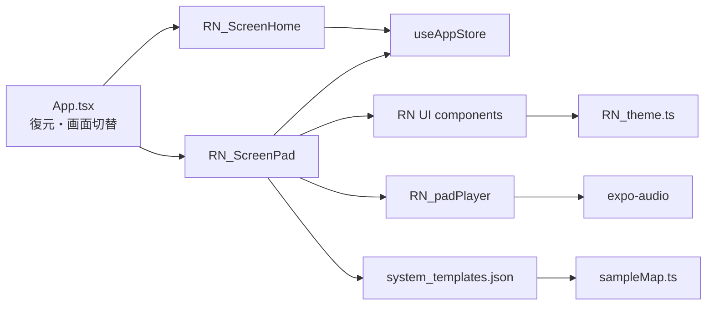

# React Native初期設計書 v0.1

対象: `app_launchpad_sampler01`  
作成: CODEX（2026-07-20）  
状態: 実装開始判定用。既存の要件・D1〜D10を変更せず、React Native実装へ具体化する。

## 0. 文書の位置づけ

本書は次の3点を一体化した実装前設計書である。

1. React Native初期設計
2. 実装順序と各段階の完了ゲート
3. MVP受け入れテスト表

仕様が競合した場合の優先順位は、以下とする。

1. `C:\00_master\APP\app_launchpad_sampler01\brief\requirements_launchpad_sampler01.md`
2. `C:\00_master\APP\app_launchpad_sampler01\brief\design_mvp_v0.1.md` の凍結判断D1〜D10
3. `C:\00_master\APP\app_launchpad_sampler01\brief\handover_to_codex_v0.1.md`
4. 本書
5. `C:\00_master\APP\app_launchpad_sampler01\brief\ui_reference_launchpad_ipad.md`

レイアウトの正は `C:\00_master\APP\app_launchpad_sampler01\brief\mockup\screen_mock_v0.1.html` とし、モック専用の画面切替ピルと脚注は実装しない。

## 1. MVPの実装境界

### 1.1 実装するもの

- Expo + React Native + TypeScript strictによるAndroid/iPad対応アプリ
- ホーム画面とパッド画面の2画面
- Rock / Jazz / Drum & Bass / HipHopの4テンプレート
- 8列×6行、計48パッド
- 各テンプレート8音以上の同梱WAV再生
- 異なるパッドの同時発音
- `idle` / `pressed` / `empty` の描画（`active`はMVP省略可）
- パッド / フィルター / ボリューム / FXの4モード
- フェーダーとFXカードのセッション内UI状態
- 選択テンプレートのAsyncStorage永続化
- 完全オフライン動作

### 1.2 実装しないもの

- 録音、停止ボタンの実機能（ヘッダー上の見た目のみ）
- 実フィルター、実ミキサー、実FX
- BPM同期、ループ、量子化、MIDI、外部音源読込、通信
- `screen_template`、外部ナビゲーションライブラリ
- ネイティブ音響モジュール、Development Build前提機能

## 2. 技術構成

| 領域 | 採用 | 責務 |
|---|---|---|
| 実行基盤 | Expo SDK 54（物理端末Expo Go互換の暫定固定） | Android/iPad共通実行、Expo Go検証 |
| 言語 | TypeScript strict | 型境界とJSON整合の静的検査 |
| UI | React Native | 画面、グリッド、入力、Safe Area |
| アニメーション | Reanimated | パッドの押下縮小・復帰・点灯 |
| 状態 | Zustand 1ストア | 選択テンプレート、モード、フェーダー、FX、押下ID |
| 永続化 | AsyncStorage | `lps01.selectedTemplateId`のみ |
| 音声 | `expo-audio` | 1割当パッドにつき1プレイヤー |
| データ | JSON + TypeScript静的sampleMap | テンプレート、配置、同梱WAV解決 |
| 検証 | `tsc` + Nodeスクリプト + Android実機 | G1〜G5の判定 |

`expo-audio`のプレイヤーは `createAudioPlayer` で生成し、再トリガー時は `seekTo(0)` の後に `play()`、破棄時は `remove()` を呼ぶ。UIは`expo-audio`を直接importしない。

2026-07-20時点ではSDK 57プロジェクトをAndroid物理端末の配布版Expo Goで開けないため、G4の実機Expo Go検証を優先してSDK 54へ暫定固定する。Expo GoがSDK 57以降へ正式対応した時点で、別タスクとして段階的アップグレードと全受け入れテストを行う。録音はMVP対象外のため、`expo-audio` config pluginの`microphonePermission`と`recordAudioAndroid`は`false`にする。

## 3. ディレクトリとファイル責務

```text
APP/app_launchpad_sampler01/
├─ App.tsx                              # Expo既定エントリ。画面切替と初期復元のみ
├─ app.json                             # アプリ設定。背景色・対象platform等
├─ assets/samples/
│  ├─ *.wav                             # 生成済みプレースホルダWAV
│  └─ LICENSES.md
├─ scripts/
│  ├─ gen_placeholder_wavs.mjs
│  └─ validate_templates.mjs
└─ src/
   ├─ audio/
   │  └─ RN_padPlayer.ts                # 音声ライフサイクルの唯一の窓口
   ├─ components/
   │  ├─ RN_FaderPanel.tsx
   │  ├─ RN_FxPanel.tsx
   │  ├─ RN_ModeRail.tsx
   │  ├─ RN_Pad.tsx
   │  ├─ RN_PadGrid.tsx
   │  ├─ RN_PadHeader.tsx
   │  └─ RN_TemplateCard.tsx
   ├─ data/
   │  ├─ RN_types.ts
   │  ├─ sampleMap.ts
   │  └─ system_templates.json
   ├─ screens/
   │  ├─ RN_ScreenHome.tsx
   │  └─ RN_ScreenPad.tsx
   ├─ state/
   │  └─ useAppStore.ts                 # D8で凍結された単一ストア
   └─ theme/
      └─ RN_theme.ts                    # 色・余白・角丸・寸法トークン
```

`App.tsx`はExpoの既定エントリ名なので`RN_`対象外とする。JSON、Nodeスクリプト、`sampleMap.ts`、Zustandストアも引継ぎ資料の「データ・スクリプト類は対象外」に従う。RN固有の画面・UI・型・テーマ・音声実装には`RN_`を付ける。

## 4. 層の契約



### 4.1 依存方向

- 画面はストア、UIコンポーネント、データ、`RN_padPlayer`を組み合わせる。
- UIコンポーネントはpropsとイベントだけを扱い、音声APIを知らない。
- `RN_padPlayer`はZustandをimportせず、引数だけで動く。
- `sampleMap.ts`だけがWAVを静的`require()`する。
- `RN_theme.ts`だけが実色コードを保持する。
- JSONはデータの正、テーマは描画色の正とする。

### 4.2 D4と配色の整合

凍結済みD4との互換のため、JSONの`color`フィールドは削除しない。ただしMVP描画は`category`から`RN_theme.ts`のカテゴリトークンを引く。`validate_templates.mjs`で`category`と`color`の既定対応を検査し、自由な色値の二重管理を防ぐ。

| category | JSON color | RNテーマ |
|---|---|---|
| drum | green | drum |
| bass | blue | bass |
| melodic | purple | melodic |
| fx | orange | fx |
| perc | indigo | perc |
| vocal | teal | vocal |

## 5. 型とデータ設計

`src/data/RN_types.ts`の基準形を以下とする。

```ts
export type TemplateId =
  | "template_rock01"
  | "template_jazz01"
  | "template_dnb01"
  | "template_hiphop01";

export type PadCategory =
  | "drum"
  | "bass"
  | "melodic"
  | "fx"
  | "perc"
  | "vocal";

export type PadColor =
  | "green"
  | "blue"
  | "purple"
  | "orange"
  | "indigo"
  | "teal"
  | "red"
  | "yellow";

export type Mode = "pad" | "filter" | "volume" | "fx";
export type PadVisualState = "idle" | "pressed" | "active" | "empty";

export interface PadDefinition {
  id: string;
  row: number;
  column: number;
  label: string;
  category: PadCategory;
  color: PadColor;
  sample?: string;
}

export interface TemplateDefinition {
  id: TemplateId;
  name: string;
  accentColor: string;
  pads: PadDefinition[];
}

export interface TemplateDocument {
  version: 1;
  templates: TemplateDefinition[];
}
```

48マス描画用データはJSONへ空パッドを追記せず、`RN_PadGrid`側で行0〜5×列0〜7を生成し、該当定義がない座標を`empty`へ変換する。キーは表示順ではなく`${row}:${column}`とする。

## 6. Zustand状態設計

D8の形状をそのまま採用する。

| 状態 | 初期値 | 永続化 | 更新元 |
|---|---:|---|---|
| `selectedTemplateId` | `template_hiphop01` | する | ホームのカード選択 |
| `mode` | `pad` | しない | 右モードレール |
| `filterFaders` | 8要素、各0.5 | しない | filterフェーダー |
| `volumeFaders` | 8要素、各0.8 | しない | volumeフェーダー |
| `fxActive` | 16要素、全false | しない | FXカード |
| `pressedPadIds` | 空配列 | しない | 各パッドのPressIn/Out |

更新アクションは配列全体を外部へ渡さず、`setMode(mode)`、`setFader(kind,index,value)`、`toggleFx(index)`、`pressPad(id)`、`releasePad(id)`、`selectTemplate(id)`の単位にする。`value`は常に`0..1`へclampし、押下IDは重複登録しない。

AsyncStorageに不明なID、空文字、読込エラーがある場合は`template_hiphop01`へフォールバックする。起動時は必ずホームを表示し、復元したテンプレートを「前回」選択として強調する。保存失敗は演奏を止めず、開発ログへ残す。

## 7. 画面遷移と起動シーケンス

### 7.1 起動

1. `App.tsx`がAsyncStorageからテンプレートIDを読む。
2. 有効な4 IDのいずれかならストアへ反映し、それ以外はHipHopを使う。
3. 復元完了までは背景色`#0c0e11`の最小ローディング表示とする。
4. `RN_ScreenHome`を表示する。
5. カード選択時にストア更新とAsyncStorage保存を開始し、`RN_ScreenPad`へ切り替える。

### 7.2 パッド画面

1. 選択テンプレートをJSONから解決する。
2. `RN_padPlayer.loadTemplate(template, sampleMap)`で割当音を先読みする。
3. ロード完了前のパッド入力は無視し、完了後に演奏可能にする。
4. 戻る操作または画面unmount時に`unloadAll()`を呼ぶ。
5. テンプレート変更が発生した場合は旧プレイヤーを全解放後、新テンプレートをロードする。

画面切替は`App.tsx`のローカル`"home" | "pad"` stateだけで行い、ナビゲーション依存を追加しない。

## 8. 音声契約

`src/audio/RN_padPlayer.ts`の公開APIは凍結済みD3/D10に合わせる。

```ts
loadTemplate(template, sampleMap): Promise<void>
trigger(padId): void
unloadAll(): void
```

内部規約:

- `Map<padId, AudioPlayer>`で保持する。
- `loadTemplate`冒頭で既存プレイヤーをすべて`remove()`する。
- `sample`を持つパッドだけプレイヤーを生成する。
- 全生成が完了してから内部マップを有効化する。
- `trigger`は未知ID・未ロードIDでは何もしない。
- `trigger`は`seekTo(0)`完了後に`play()`する。公開APIは`void`のまま、内部Promiseの失敗を開発ログへ記録する。
- 同じパッドの連打は先頭へ戻して自己チョークする。
- 異なるパッドは別プレイヤーなので同時に鳴る。
- 一部ロード失敗時は生成済みプレイヤーを全解放して`loadTemplate`をrejectし、半端なマップを残さない。
- `unloadAll`は複数回呼ばれても安全な冪等処理にする。

## 9. UIレイアウト設計

### 9.1 共通

- 背景`#0c0e11`、Safe Area内に描画する。
- 基準は横向きタブレット。幅・高さは`useWindowDimensions()`から算出する。
- 横向きでは画面幅へ収め、モックの比率・余白・並びを維持する。
- Androidスマートフォン縦向きは、最小横幅を持つコンテンツを横スクロール表示して48マスの順序と押下サイズを守る。別レイアウトへ再配置しない。
- 外部フォントやネットワーク画像は使わない。

### 9.2 トークン

| トークン | 値 |
|---|---|
| `bg` | `#0c0e11` |
| `bgElev` | `#16191e` |
| `bgCard` | `#1d2127` |
| `text` | `#f2f3f5` |
| `textDim` | `#8a919b` |
| `accentFallback` | `#ff5b2b` |
| `radiusPanel` | 14 |
| `radiusPad` | 10 |
| `screenPadX` | 14 |
| `screenPadTop` | 10 |
| `layoutGap` | 10 |
| `gridGap` | 6 |
| `railWidth` | 86 |
| `headerHeight` | 44 |
| `pressedScale` | 0.96 |
| `releaseDurationMs` | 120 |

カテゴリのbase / ink / lit値は引継ぎ資料§2.3をそのまま`RN_theme.ts`へ転記する。選択アクセントは現在テンプレートの`accentColor`を使い、取得不能時のみ`accentFallback`を使う。

| template | accentColor | アートグラデーション |
|---|---|---|
| Rock | `#e64545` | `#8c1f1f` → `#e64545` |
| Jazz | `#d9a441` | `#6b4a12` → `#d9a441` |
| Drum & Bass | `#2fb5a8` | `#0b4f5e` → `#2fb5a8` |
| HipHop | `#ff5b2b` | `#7a2708` → `#ff5b2b` |

### 9.3 `RN_ScreenHome`

- タイトルとサブタイトルの下に4カードを横一列で置く。
- 基準カード寸法は190×230、カード間20、内側余白18、角丸18。
- カード内アートは高さ96、角丸12。
- Rock=赤、Jazz=黄土、Drum & Bass=ティール、HipHop=オレンジのグラデーションをコードで描画する。
- 復元済みカードに2px相当のアクセント枠と「前回」バッジを出す。
- 幅不足時は横ScrollViewとし、カードを縮小して2段化しない。

### 9.4 `RN_ScreenPad`

- ヘッダー44px相当、その下を`padmain | rail`の横並びにする。
- ヘッダーは戻る、テンプレートアイコン+名前、spacer、`⋯`、録音アイコン、停止アイコンの順。
- `padmain`はグリッドと下部パネルの縦並び、間隔10。
- `rail`は幅86、4ボタンを下寄せ縦積み、ボタン高さ76、間隔8。
- `mode === "pad"`ではグリッドが利用可能高を占有し、下部パネルは描画しない。
- それ以外ではグリッド高を`padmain`の46%相当に固定し、残りへパネルを表示する。

### 9.5 `RN_PadGrid` / `RN_Pad`

- 8列×6行を必ずrow-major順で描画する。
- 行列寸法は利用可能幅・高さとgapから計算し、各マスを均等寸法にする。
- 通常表示はカテゴリ円アイコン、カテゴリ名、パッド名の3層。
- compact表示はカテゴリ名を隠し、アイコンを30から20相当へ縮小する。
- `empty`は暗グレー、破線枠、操作不可。
- `onPressIn`でストアへ押下IDを追加し、同時に`trigger(id)`を呼ぶ。
- `onPressOut` / `onTouchCancel`で120ms以内に押下IDを解除する。
- `pressed`はlit背景、白文字、scale 0.96。`active`はMVPでは実装しなくてよい。
- パッド入力は各`Pressable`で独立して処理し、異なる2パッドの同時押下を妨げる全画面Responderを置かない。

### 9.6 `RN_FaderPanel`

- `variant: "filter" | "volume"`と8値配列を受け取る。
- filterは細い暗色トラックと横長ノブ、volumeは太い暗色トラックと下からのアクセント色fill。
- `PanResponder`でパネル内Y座標を`0..1`へ正規化し、ドラッグ中に連続更新する。
- フェーダー操作は音声層へ渡さない。

### 9.7 `RN_FxPanel`

- 2行×8列、計16カードを固定表示する。
- ラベル順はモックのFX配列を正とする。
- タップで対応する`fxActive[index]`だけを反転する。
- 点灯時は`fx.lit`背景、白文字・白アイコン。音声層へ渡さない。

## 10. エラー・終了処理

| 事象 | 挙動 |
|---|---|
| AsyncStorage読込失敗 | HipHopへフォールバックしてホーム表示 |
| 保存失敗 | 現セッションの選択と演奏は継続、開発ログへ記録 |
| JSONに未知テンプレート | 選択対象から除外し、検証スクリプトをfail |
| sampleMap不一致 | ビルド前検証をfail。実行時ロードもreject |
| 音源ロード失敗 | 半端なプレイヤーを全解放し、入力を有効化しない |
| 未割当パッド押下 | イベントを発生させない |
| 画面離脱 | 押下IDを解除し、全プレイヤーを解放 |

## 11. 実装順序と完了ゲート

SolからTerraへは「段階3終了後」に移行可能とする。ただし音声契約の変更、仕様矛盾、複数層にまたがる不具合、最終受け入れ判定はSolへ戻す。

| 段階 | 対応T# | 実装内容 | 完了ゲート | 推奨モデル |
|---|---|---|---|---|
| 0 | 事前 | 本書、正資料、命名、依存方向、テストIDを確定 | 未裁定の実装阻害事項が0 | Sol |
| 1 | T1 | Expo scaffold、strict、依存、プロジェクト内`.gitignore` | `npx tsc --noEmit`が通る。Expo設定と依存が矛盾しない | Sol |
| 2 | T2 | 決定的WAV生成、32音、LICENSES | 2回生成のhash/diff一致、RIFF/44.1kHz/16bit/mono確認 | Sol |
| 3 | T3 | 型、4テンプレートJSON、sampleMap、validator、RN_theme | validatorが5項目+category/color対応をpass | Sol |
| 4 | T4 | `RN_padPlayer`のロード、再生、解放 | 単体の契約確認。未知ID安全、unload冪等、部分失敗後に残存0 | Sol |
| 5A | T5 | HipHopだけでScreenPad、48マス、押下、音声 | HipHop 8音以上、押下表示、異なる2パッド同時発音 | Terra、レビューSol |
| 5B | T5 | 4テンプレートへ一般化 | 全テンプレート8音以上、配置と配色一致 | Terra |
| 6 | T6 | モードレール、compact、2種フェーダー、FX | 4モードとUI状態が受入表どおり | Terra |
| 7 | T7 | Home、復元、保存、画面切替 | 4カード、前回表示、再起動復元 | Terra |
| 8A | T8 | 静的・スクリプト検証 | G1/G2/G3/G5がpass | Terra |
| 8B | T8 | Android実機検証と検証シート | G4の8項目がpass、証跡記入 | Sol判定 |

各段階は前段のゲートを通過してから次へ進む。段階5AまではHipHopを縦切りで完成させ、音が鳴らない状態のまま全画面を先行実装しない。

## 12. 受け入れテスト表

### 12.1 自動・静的テスト

| ID | 対応 | 種別 | 手順 | 合格条件 |
|---|---|---|---|---|
| AT-01 | G1 | 自動 | `npx tsc --noEmit` | exit 0、TypeScriptエラー0 |
| AT-02 | G2 | 自動 | `node scripts/validate_templates.mjs` | 4テンプレート、各8 sample以上、sample実在、sampleMap一致、座標範囲/重複なしを全pass |
| AT-03 | D4/D5 | 自動 | validatorのcategory/color検査 | 6カテゴリが既定color対応と一致 |
| AT-04 | G3 | 自動 | WAV生成前後のhash一覧を2回比較 | 全32ファイルの名前・サイズ・hashが一致 |
| AT-05 | D7 | 自動 | 生成WAVのヘッダーを検査 | RIFF/WAVE、PCM 16bit、44.1kHz、mono |
| AT-06 | G5 | 静的 | `git status --short`と`.gitignore`確認 | node_modules、.expo、一時ファイルが追跡対象外 |
| AT-07 | D10 | 静的 | `rg "expo-audio" src` | importが`src/audio/RN_padPlayer.ts`だけ |
| AT-08 | 命名 | 静的 | UI/RN固有ファイル一覧を確認 | 対象ファイルが`RN_`接頭辞、例外は本書§3のみ |
| AT-09 | データ | 自動 | 空座標展開テスト | 各テンプレートが必ず48セル、座標順がrow-major |
| AT-10 | 状態 | 単体 | store actionを呼ぶ | 8/8/16の長さ維持、値clamp、押下ID重複なし |

### 12.2 Android実機・Expo Go手動テスト

| ID | 対応 | 事前条件 | 操作 | 合格条件 |
|---|---|---|---|---|
| MT-01 | G4-1 / FR-01 | 初回起動 | ホームを見る | 4テンプレートが横並びで表示され、各カードを選択できる |
| MT-02 | G4-2 / FR-03 | HipHop選択 | 割当パッドを順に押す | 8音以上が対応ラベルどおり1回ずつ鳴る |
| MT-03 | FR-01 | 各テンプレート選択 | Rock/Jazz/DnB/HipHopで割当パッドを押す | 名前、カテゴリ色、音がテンプレートごとに切り替わる |
| MT-04 | G4-3 | 音源ロード完了 | 異なる2パッドを同時押し | 両方の音が重なり、アプリが停止しない |
| MT-05 | 成功条件 | 音源ロード完了 | 8パッド以上を連続して叩く | クラッシュ、入力停止、明らかな音声固着がない |
| MT-06 | G4-4 / FR-02 | 任意の有音パッド | 押して離す | 次フレーム相当でlit+白文字+0.96縮小、離して約120ms以内にidleへ戻る |
| MT-07 | FR-02 | 空パッド表示 | 空パッドを押す | 破線・暗色のまま、点灯も発音もしない |
| MT-08 | G4-5 / FR-04 | パッド画面 | 4モードを順に選択 | 選択レールがアクセント表示。pad以外はグリッド46%相当+該当パネル |
| MT-09 | FR-04 | filter/volume | 両モードを比較 | filterは細トラック+ノブ、volumeは太い塗りバーで明確に異なる |
| MT-10 | G4-6 / FR-05 | filter/volume | 8本すべて上下ドラッグ | 指へ滑らかに追従し0..1内で止まる。実音は変化しない |
| MT-11 | G4-6 / FR-05 | FXモード | 複数FXカードを2回ずつタップ | 個別に点灯/消灯し、他カード状態を壊さない。実音は変化しない |
| MT-12 | 状態 | 任意テンプレート | UI状態変更後に別テンプレートへ移る | フェーダー/FX状態はセッション内で維持される |
| MT-13 | G4-7 / NFR | 機内モード | 完全終了後に起動し演奏 | 通信なしでホーム表示・テンプレート選択・WAV再生ができる |
| MT-14 | G4-8 / FR-01 | Rockを選択 | 完全終了して再起動 | ホームでRockが「前回」として復元される |
| MT-15 | レイアウト | 横向きタブレット | Home/Pad/全モードを確認 | HTMLモックと要素順、比率、配色、状態表現が一致し、48マスと右レールが画面内に収まる |
| MT-16 | 対応端末 | Androidスマホ縦向き | Home/Padを表示し横スクロール | 要素順を保ち、空・有音パッドを押せる。極端な縮小や重なりがない |
| MT-17 | 終了処理 | 音を鳴らす | Homeへ戻り、再びPadへ入る操作を反復 | 二重再生、古いテンプレート音、クラッシュが発生しない |
| MT-18 | ヘッダー | パッド画面 | `⋯`、録音、停止を押す | MVPでは誤った録音・停止処理を開始しない。レイアウトが崩れない |

### 12.3 証跡記録

T8で `C:\00_master\APP\app_launchpad_sampler01\reports\report_launchpad_mvp_v0.1_verification.md` を作り、各IDについて実施端末、OS、Expo/SDK版、日時、pass/fail、所見、再検証結果を記録する。実機が必要なMT項目は、端末未接続のままpass扱いにしない。

## 13. Terra移行判定

次のすべてを満たした時点で、定型実装をTerraへ移す。

- D1〜D10と本書の間に未解決の矛盾がない。
- ディレクトリ、型、テーマ、JSON、sampleMapが確定している。
- `validate_templates.mjs`がpassする。
- `RN_padPlayer`の公開APIと解放規約が固定されている。
- 受け入れテストIDが実装タスクへ紐づいている。

次の場合はSolへ戻す。

- 公開APIまたはJSONスキーマを変える必要が出た。
- 音声ロード・同時発音・解放で端末依存問題が出た。
- HTMLモック1:1踏襲と端末寸法の両立に設計判断が必要になった。
- 2層以上にまたがる不具合、受け入れ基準の解釈問題、最終合否判定が発生した。

## 14. 実装開始判定

本書作成時点で、T1〜T4をSolで開始できる。Terra移行は段階3完了後を最短地点とするが、`RN_padPlayer`は品質上の中核なのでSolで完成させ、段階5以降のUI定型実装をTerraへ渡す運用を推奨する。

実装中に本書の範囲で解決できない曖昧さが見つかった場合は、`C:\00_master\APP\app_launchpad_sampler01\brief\spec_return_log.md`へSR-###を起票し、関係箇所だけ停止する。

## 15. 技術参照

- Expo Audio: `https://docs.expo.dev/versions/latest/sdk/audio/`
- Expo app config（orientation等）: `https://docs.expo.dev/versions/latest/config/app/`
- Expo Safe Areas: `https://docs.expo.dev/develop/user-interface/safe-areas/`

SDKの具体的なパッチ版と型定義は`package.json`と`package-lock.json`を正とする。SDKメジャーは物理端末Expo Goとの互換性のため54へ暫定固定し、アップグレードは互換確認後に別タスクで行う。
